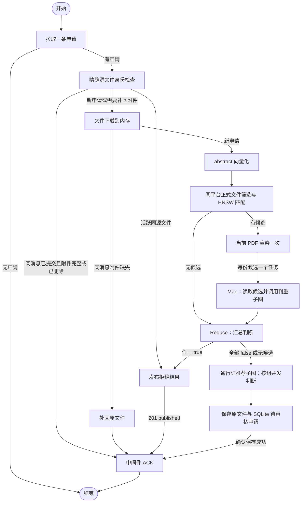

# 入库申请工作流

本工作流通过 LangGraph 处理单条入库申请。已实现申请拉取、内存下载、摘要向量化、同平台正式资源候选检索、并行比较调度与汇总、重复拒绝反馈及 ACK。

> **当前阶段：** 节点 C 已接入[文件判重子图](../file-deduplication/readme.md)，推荐节点已接入[通行证推荐子图](../passport-recommendation/readme.md)。待审核落盘已实现，文件判重智能体已实现对话循环，通行证推荐已实现按组并发模型判断和 JSON 验收。完整工作流已接入 FastAPI 的[后台接收服务](../../../capability/application/ingestion-consumer.md)，持续执行自动拒绝或 SQLite 待审暂存，随后确认消费。人工审批已通过[入库审核接口](../../../api/ingestion-review.md)实现。

---

## 总体拓扑



一次执行只处理一条申请，图内没有无限轮询。外层由[后台接收服务](../../../capability/application/ingestion-consumer.md)负责轮询、整体重试和已提交申请恢复；异常不会通过错误分支继续 ACK。

---

## 已实现节点

| 节点 | 职责 |
| --- | --- |
| `pull_request` | 调用中间件 pull，校验申请；204 时结束。新申请清除上次比较结果和成功标记。 |
| `check_source_identity` | 精确查询同平台源文件；活跃同源新申请直接拒绝，已提交同消息恢复 ACK。 |
| `restore_committed_file` | 仅补回已提交消息的缺失原附件，不重复智能体流程或修改审核状态。 |
| `download_file` | 分块下载附件到内存，检查响应长度、实际长度和大小上限，不创建资源文件。 |
| `embed_abstract` | 使用 vLLM/LlamaIndex 对 `abstract` 向量化；摘要缺失时中断，不跳过去重。 |
| `find_duplicate_candidates` | 从正式 `resources` 表限定平台和非空向量，刷新该平台索引缓存，再执行 HNSW。 |
| `prepare_comparison_file` | 有候选时将当前 PDF 渲染一次，并行分支共享同一页面与 UUID。 |
| `compare_files` | 按平台与附件文件名读取候选 PDF，构造双方名称、摘要和页面对象，调用判重子图；只接受严格 boolean 和非空理由。 |
| `reduce_comparisons` | 校验候选与结果对应完整，按任一重复的规则选择分支。 |
| `publish_rejection` | 将命中文件 source_id 与智能体理由组织为 Markdown 审核意见，由固定审核员发布空通行证结果；仅确认发布后标记成功。 |
| `recommend_passports` | 传入名称、摘要、已有向量及共享 PDF 页面；必要时延迟渲染，接收通行证及理由列表。 |
| `persist_pending_review` | 调用持久化服务，保存原文件及向量、推荐理由，提交后返回资源 ID。 |
| `acknowledge_request` | 拒绝凭据或完整 SQLite 待审核申请已保存后确认消费。 |

判重子图通过工具循环形成已校验结论，失败返回未知；通行证推荐子图已实现跨平台 HNSW 搜索与通行证聚合、并发判断调度及结果收束。缺少搜索运行依赖时抛出 `RuntimeError`，非空组默认并发调用模型，预算、格式或证据校验失败时整体失败，不落盘、不 ACK。持久化行为见[待审核文件持久化](../../../capability/application/pending-review.md)。待审核原文件先保存到 `REVIEW_LOG_ROOT/tmp-file/ingestion`；审核通过后由人工入库审核服务转移到 resource，文件能力见[审核文件存储](../../../capability/infrastructure/review-file-storage.md)。当前拒绝分支不保存申请文件，不向 `resources` 插入申请记录；会保存 SQLite 审核意见和发布凭据。正常分支将完整待审核申请存入 SQLite，返回 `review_id` 后 ACK，审核通过前不写入 MySQL。正常分支在 ACK 前完成 SQLite 审核记录，契约见[审核表](../../data/review.md)。

---

## C 的 Map-Reduce 约定

匹配到五份候选时，LangGraph 通过五个 `Send` 调度五次比较。当前 PDF 在 `prepare_comparison_file` 中只准备一次；每个比较任务收到申请元信息、共享的 `current_pdf` 和一个候选引用。在并发额度内读取对应候选 PDF，再将双方的 `name`、`abstract`、`PreparedPDF` 适配为子图输入。名称与摘要来自申请和正式资源查询，文件地址只保存附件文件名。

`comparison_results` 使用追加 reducer 汇总候选结果；其他状态按节点覆盖。任务并发上限默认 10，可通过配置调整。每个任务记录资源 ID、布尔结论、智能体理由或错误类型，不保存失败对话原文。命中的模型理由保留为 `duplicate_reason`，中间件拒绝说明仍按既定契约构造。

推荐成功后，`passport_recommendations` 保留完整的 `{passport, reason}` 条目及顺序；`None` 表示尚未推荐，`[]` 表示明确无候选。推荐异常或无效输出不会进入保存与 ACK，详细契约由[推荐子图](../passport-recommendation/readme.md)维护。

汇总在该批比较结束后执行：

- 任一结果为 true：拒绝；优先采用候选排序中第一个具有有效 `source_id` 的重复文件。
- 所有结果为 false：进入通行证推荐。
- 没有候选：跳过比较，进入通行证推荐。
- 无 true 且存在失败、未知或不完整结果：中断，不默认认为不重复。
- 确认重复但命中文件均缺少 `source_id`：中断，不使用内部资源主键伪造文件 ID。

默认判重子图已实现多轮读页、友好折叠和有限纠错；执行及配置见[判重上下文](../file-deduplication/context.md)。失败不伪造 boolean，模型局部对话不进入权威业务状态。

---

## 正式资源检索与 HNSW 缓存

`MySQLResourceRepository.list_vectors` 以 `source_platform` 查询正式资源表并排除空向量；表中行均为已入库文件，不再过滤状态。`ReadyResourceSearch` 校验维度，清理并替换该平台在 `myvector_documents` 中的缓存，再通过 `MyVectorStore` 取得候选。

默认最多返回 5 份且余弦相似度不低于 0.8 的文件，两者可配置。候选包含内部 `resource_id`、来源 `source_id`、平台、附件文件名、`name`、`abstract`、`applicant`、`reviewer` 和相似度；拒绝反馈使用 `source_id`。

`myvector_documents` 是可重建的索引缓存，不是资源状态的权威来源。刷新只写入已有正式文件的索引信息，不保存申请文件或申请资源记录。正式资源的新增、删除和向量变化将在下一次平台检索时反映；当前依赖单实例刷新锁，同一批快照读取后发生的并发审核变更不提供跨系统快照隔离。

正式 `resources.embedding` 目前没有模型版本字段；参与检索的向量须由配置中的同一模型生成，系统校验维度但无法仅凭维度判断模型是否相同。缓存当前配置为 4096 维、容量 10,000；重建前校验字段维度和容量，超限时中断。HNSW 的候选扩展和精确兜底见 [MyVector 说明](../../../capability/infrastructure/myvector.md)。

---

## 拒绝结果契约

调用 `POST /middleware-service/api/ingestion-results/publish`，携带注册中心 Bearer token，JSON 为：

```json
{
  "request_id": "原申请 message_id",
  "target_platform_code": "原申请 platform_code",
  "note": "## 入库申请拒绝\n\n经自动审核，当前文件与已有文件重复，拒绝入库。\n\n### 重复文件\n\n- **文件 source_id：** `source-3`\n\n### 重复理由\n\n正文及签章内容一致。",
  "reviewer": "注册中心自动审核员",
  "passport": []
}
```

审核说明由 `build_duplicate_rejection_note` 构造，使用二级结论标题、三级文件与理由标题，并在段落和列表间保留空行。展示效果如下：

```markdown
## 入库申请拒绝

经自动审核，当前文件与已有文件重复，拒绝入库。

### 重复文件

- **文件 source_id：** `source-3`

### 重复理由

正文及签章内容一致。
```

文件身份使用命中的 `source_id`，不使用内部资源主键或消息 ID；以 Markdown 行内代码展示，包含反引号时动态选择分隔符。判重分支的模型理由保留其段落和 Markdown 排版，只移除首尾空白；精确身份阻断则使用已有 SQLite 待审核申请或正式资源对应的明确理由，不调用智能体。审核员固定为 `注册中心自动审核员`，不由环境变量、入库申请或智能体输出覆盖；已移除 `INGESTION_REJECTION_REVIEWER` 配置。

source_id 或理由缺失时不发布；完整 note 超过中间件 10000 字符上限时明确失败，不静默裁剪模型理由，也不 ACK。重复拒绝仍使用 `passport=[]`。

发布失败、503、非法响应或 409 均不 ACK。当前 409 无法证明此前反馈内容与本次拒绝一致，不能直接当作发布成功；SQLite 已保存反馈消息 ID 时，重投复用拒绝意见直接 ACK；发布成功但凭据保存失败的窗口仍需中间件支持。401 会失效本次使用的会话令牌。

接口依据中间件的[审核反馈接口](../../../../../middleware-service/description/api/ingestion-review.md)。

---

## 配置与调用

| 配置项 | 默认值 | 用途 |
| --- | --- | --- |
| `INGESTION_MAX_FILE_BYTES` | `67108864` | 内存下载上限，64 MiB。 |
| `INGESTION_DUPLICATE_TOP_K` | `5` | 去重候选数量，范围 1 至 100。 |
| `INGESTION_DUPLICATE_MIN_SIMILARITY` | `0.8` | 最低余弦相似度，范围 -1 至 1。 |
| `INGESTION_COMPARISON_CONCURRENCY` | `10` | 同一 context 内比较任务的并发上限。 |

[源文件身份规则](../../../capability/application/source-identity.md)同时作用于本工作流与当前后台消费者，并由数据库活跃唯一索引保证并发安全；源 ID 缺失时不作精确身份拦截。

下载总超时复用 `INGESTION_DOWNLOAD_TIMEOUT_SECONDS`，模型配置见 [MyVector 与 vLLM](../../../capability/infrastructure/myvector.md)。上限约束的是单份申请文件内容，下载结束转换为 bytes 时存在短暂额外副本。

`IngestionWorkflowContext` 接收中间件客户端、已启动的会话服务、embedding 服务、候选检索服务、配置、判重子图、子图运行 context、PDF 服务和 SQLite 审核仓库 `reviews`。可从 `pending_review_service.reviews` 自动取得共享审核仓库；创建者负责初始化和关闭 SQLite。默认创建判重子图及 PDF 服务；实际模型客户端可由子图 context 注入，未注入时由判断节点创建并关闭。依赖与令牌不进入状态，创建者负责启动与关闭服务，连接池须先初始化。例：

```python
from app.service.resource_candidates import ReadyResourceSearch
from app.workflow.ingestion import build_ingestion_workflow
from app.workflow.ingestion.context import IngestionWorkflowContext
from app.infrastructure.resource_store import ResourceFileStore
from app.service.pending_review import PendingReviewService

pending_review_service = PendingReviewService(
    repository, ResourceFileStore(ingestion_settings.ingestion_file_root),
    max_file_bytes=ingestion_settings.max_file_bytes,
    reviews=review_repository,
)
context = IngestionWorkflowContext(
    middleware=middleware_client,
    sessions=session_service,
    embeddings=embedding_service,
    candidates=ReadyResourceSearch(
        repository,
        model_name=embedding_service.settings.model,
        dimensions=embedding_service.settings.dimensions,
    ),
    settings=ingestion_settings,
    pending_review_service=pending_review_service,
)
workflow = build_ingestion_workflow(interrupt_before_comparison=True)
state = await workflow.ainvoke({}, context=context)
```

此调用在公共 PDF 渲染和 C 之前暂停；身份拒绝、原文件恢复和 ACK 也会暂停，不发布结果、不落盘、不 ACK；未设置检查点存储，不支持借此自动恢复。启用默认判重子图可运行比较和拒绝分支；非重复分支自动复用已有 HNSW 搜索服务，执行跨平台候选检索与通行证聚合；非空组默认并发调用模型；复用判重已渲染页面，没有判重候选时仅在有推荐组后渲染一次。没有匹配组时输出空推荐，不额外渲染或调用模型。提供持久化服务后，推荐成功可保存待审核记录并 ACK。

---

## 验证

```bash
conda activate registry-be
python -m unittest discover -s tests
```

测试覆盖五并发、并发限流、零候选、全 false、任一 true、未知结果、发布失败和 409 不 ACK、拒绝说明与 source_id，以及内存上限。

隔离联调使用真实 vLLM、MySQL 8.4.11 和 MyVector，验证 ready 平台筛选、HNSW 快照及状态变化；对比函数使用确定性替身。拒绝接口另通过真实中间件和隔离 RabbitMQ 流验证发布、子平台拉取及确认，测试流已清理。

Map-Reduce 构建参考 [LangGraph Send API](https://docs.langchain.com/oss/python/langgraph/use-graph-api#map-reduce-and-the-send-api)。
