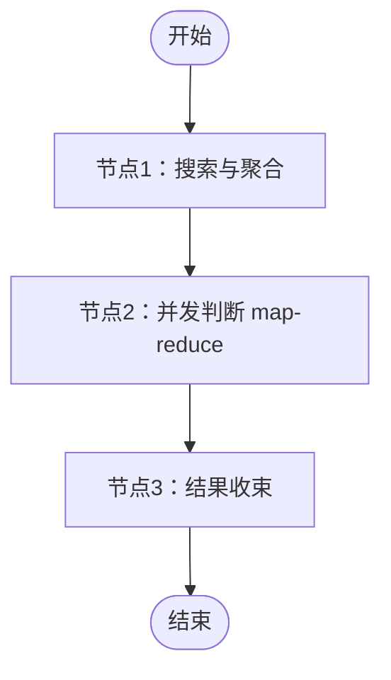

# 通行证推荐子图

> **当前阶段：** 已实现节点 1 的跨平台 HNSW 搜索与通行证聚合，复用入库主图已有的检索服务。节点 2 已实现按组并发 MLLM 判断及[消息与 JSON 验收](prompt.md)；节点 3 已实现结果收束。缺少依赖时明确失败，不返回占位空推荐。

---

## 三节点结构



图无法渲染时，按“开始 → 搜索与聚合 → 并发判断 → 结果收束 → 结束”阅读。首节点包含输入校验，末节点包含完整性及输出校验，不增加额外校验节点；第二节点在内部执行 map-reduce，不把每个组展开为额外 LangGraph 节点。

| 节点 | 程序名称 | 输入与职责 | 输出 |
| --- | --- | --- | --- |
| 1 | `search_and_aggregate` | 校验当前文件；调用跨平台阈值检索与通行证聚合依赖，验收分组。 | 当前文件、通行证组列表。 |
| 2 | `map_reduce_judgments` | 一个通行证组一项并发任务，判断是否值得推荐及理由；等待全部结果。 | 每组恰好一个判断。 |
| 3 | `collect_results` | 检查组与判断一一对应；筛选明确推荐的组，保持组顺序并校验最终契约。 | 通行证及理由列表。 |

子图不下载文件、不再次向量化、不判重、不持久化或 ACK；这些职责属于[入库主图](../ingestion/readme.md)。没有通用工作区或额外管理工具。

---

## 输入与搜索聚合契约

文件元数据保持 `file: PassportRecommendationInput`；默认模型判断另接收可选 `current_pdf: PreparedPDF`，或由 context 的 `prepare_pdf()` 延迟准备：

```yaml
file:
  name: 当前文件名称，未知为 null
  abstract: 当前文件摘要
  abstract_embedding: 已生成的非零有限摘要向量
```

名称最多 200 字符；摘要必填、非空白、最多 10000 字符；向量为 1 至 4096 维，不接受 boolean、字符串、非有限值或零向量。实际维度由检索服务按模型配置检查，不重新生成向量。

节点 1 默认使用 `PassportGroupSearch.search(file)`，调用已有 `ReadyResourceSearch.search_all_platforms`，由 `MyVectorStore.aquery` 执行 HNSW/Cosine 搜索。不在推荐子图内另行计算向量距离；复用输入向量及搜索服务绑定的模型、维度，不调用 embedding 服务。

搜索先读取所有平台的 MySQL 正式 `resources`，排除无向量和空通行证的文件，刷新当前模型的 `ready` 索引缓存，再请求独立配置的 Top-K 近邻。查询不限制来源平台；正式资源表仅保存已入库文件，SQLite 待审核申请不进入索引。`null` 或空通行证数组的文件不占用推荐候选名额；数组元素须通过非空白校验。

搜索结果仅保留 `similarity > min_similarity` 的条目，等于阈值不入选，再按通行证原字符串精确聚合，不裁剪空格、不改变大小写。同一通行证的文件可以来自不同平台。组内按相似度降序排列，同分按资源 ID 升序排列；组按最高相似度降序排列，同分按通行证原字符串排序。

HNSW 为近似 Top-K 搜索，不保证取回所有超过阈值的文件。沿用既有封装的候选扩展和强筛选精确兜底，未新增全量余弦扫描；候选数量上限仍是 100。输入或正式资源向量校验失败、数据库或索引操作失败时整体失败，不当作无匹配。

正式 `resources` 仅执行 SELECT；`myvector_documents` 为可重建缓存，需要写入、删除和索引管理权限。全平台快照先删除当前模型的 `ready` 缓存，避免已删除资源、旧通行证或此前平台快照残留；保留其他模型和状态。与判重共用搜索服务及其锁，使同平台与跨平台的快照刷新、查询在实例内串行执行。

返回 `list[PassportGroup]`，示意如下：

```yaml
groups:
  - passport: passport-001
    files:
      - resource_id: 1
        source_platform: platform-a
        name: 采购合同
        abstract: 设备采购与交付
        similarity: 0.92
      - resource_id: 2
        source_platform: platform-b
        name: 技术说明
        abstract: 设备安装与使用
        similarity: 0.87
```

通行证为非空白字符串，最多 512 字符；每组至少一个文件。文件 ID 为严格正整数，平台为非空字符串；文件名称、摘要允许未知 `null`，相似度为有限的 -1 至 1 数值。组内不能重复文件，同一通行证不能拆成多个组，同一正式文件可属于多个通行证组，但跨组的资源描述和相似度必须一致。

`[]` 表示搜索成功且没有可推荐的通行证组。`None`、缺少分组或搜索失败不能解释为空组；每次搜索成功都重置内部判断，不继承上一申请的结果。

---

## 并发判断契约与执行边界

默认每组调用 `agent.judge_group`，接收当前文件、完整 PDF 页面、绑定文件组和共享 MLLM 客户端，返回 `PassportGroupJudgment`。可用 `group_judge(file, group)` 显式覆盖判断行为：

```yaml
evidence:
  - current_page: 1
    group_file_index: 1
    finding: 当前页及本组条目 1 的摘要均说明同一项目的设备事项
reasoning: 两份资料关联同一明确项目，构成采购与安装的配套关系
should_recommend: true
reason: 当前文件与该通行证关联的设备采购和安装资料形成明确关联
```

输出顺序为 `evidence → reasoning → should_recommend → reason`。推荐必须具有可核对证据；证据引用当前物理页及组内条目序号。`should_recommend` 必须是严格 boolean，未知或非法输出不能冒充 false；明确因具体关联依据不足而不推荐是合法建议，不代表证明文件无关。论证和面向审核者的理由必须分别非空白；具体边界由[提示词与判断契约](prompt.md)维护。

模型不能返回或改写通行证身份，程序将完整判断与该组通行证绑定为 `PassportGroupDecision`。默认调用验收完整页面、页码和组内条目上界；并发节点再次验收结果。

节点 2 使用 `asyncio.TaskGroup` 执行组级 map-reduce，由独立的 `judgment_concurrency` 限制同时执行数量，默认 10；它不是模型 HTTP 配额或入库判重并发。任务完成先后不改变组顺序。任一任务失败时取消并等待其他任务，整体失败，不输出部分推荐。

空组直接产生空判断，不创建模型客户端或准备页面。非空组默认使用真实 MLLM 判断，无需注入 `group_judge`；缺少 `current_pdf` 和 `prepare_pdf` 时抛出 `RuntimeError`。准备函数在并发之前仅调用一次，所有组复用同一份 PNG 与 UUID。

任务共享一个 MLLM 客户端，并沿用 worker 的模型 HTTP 总并发配额。显式注入的客户端由调用者关闭；默认创建的客户端在任务完成或失败取消后释放。模型错误、截断、格式或证据校验失败时整体失败，不输出部分结果，不进入主图落盘与 ACK。

---

## 结果收束与对外输出

节点 3 检查每个组恰好对应一个判断，并按实际组和当前文件页数重新校验证据引用；遗漏、重复、其他组身份、非严格 boolean、无效理由或越界引用均失败，包括明确不推荐的判断。所有判断通过后，只筛选明确 `true` 的组，子图直接输出：

```yaml
recommendations:
  - passport: passport-001
    reason: 推荐理由
```

输出状态仅有顶层 `recommendations` 列表，每项只有 `passport`、`reason`，不再嵌套 `result`。`reason` 原样取自智能体面向审核者的最终推荐理由，不使用内部 `reasoning` 替代，不混入 evidence、boolean、组内文件或模型对话。理由不能为空，通行证不重复，排序沿用搜索聚合的组顺序，不受判断完成先后影响。搜索为空或全部明确不推荐时返回 `recommendations: []`；并发失败不会进入结果收束形成空列表。

收束节点不调用模型，也不拼接或改写理由。入库主图按此顶层契约验收，再将列表写入待审核记录。

---

## 文件结构与依赖接入

| 文件 | 职责 |
| --- | --- |
| `state.py` | 当前文件、正式文件组、组判断与最终推荐契约。 |
| `context.py` | 共享搜索与模型、推荐配置、页面准备、判断覆盖及审计回调。 |
| `search.py` | 复用跨平台 HNSW 候选，按通行证聚合和排序。 |
| `prompt.py` | 固定系统提示词及实际 Pydantic JSON Schema。 |
| `message.py` | 当前全文与名称摘要的共享消息、组内文件描述后缀。 |
| `agent.py` | 单组真实请求、预算、严格 JSON 与证据验收、私有审计。 |
| `node.py` | 三个功能节点及贯穿首尾的契约校验。 |
| `workflow.py` | 固定三个节点及顺序。 |
| `__init__.py` | 导出构建器及对外契约。 |

```python
from app.agent.passport_recommendation import build_passport_recommendation_workflow
from app.agent.passport_recommendation.context import PassportRecommendationContext
from app.config.passport_recommendation import load_passport_recommendation_settings

# 复用已有搜索与模型客户端，当前文件页面通过输入提供。
context = PassportRecommendationContext(
    mllm=mllm_client,
    resource_search=ready_resource_search,
    search_settings=load_passport_recommendation_settings(),
    judgment_concurrency=10,
)
output = await build_passport_recommendation_workflow().ainvoke(
    {"file": file_input, "current_pdf": prepared_pdf}, context=context,
)
```

可通过 `group_search` 覆盖默认搜索，返回已聚合的文件组；`group_judge` 为可选覆盖，返回单组判断；未提供时默认调用实际模型。回调既可返回对应 Pydantic 模型，也可返回可通过该模型校验的字典。未提供搜索回调时必须提供 `resource_search: ReadyResourceSearch`，缺失时抛出 `RuntimeError`；未显式注入 `search_settings` 时读取独立推荐配置。搜索服务使用的数据库仓库和模型客户端由注入者关闭。

入库主图的 `IngestionWorkflowContext` 自动复用 `candidates` 中的 HNSW 搜索实例，保留显式注入的搜索回调、搜索实例、推荐配置、判断回调及并发数。配置加载或检索失败时，不进入 SQLite 待审核落盘与 ACK。

不再通过 `recommendation_node` 替换整段节点；测试与实际扩展通过上述依赖注入，始终执行三节点调度及首尾校验。

---

## 搜索配置与规模边界

一份召回文件可以持有多个通行证；HNSW 按文件召回后，将它分配至数组中每个通行证的组，同一组不重复添加该文件。推荐条目和单组输出的 passport 仍是字符串，最终人工审核可选择多项，见[通行证数组契约](../../data/passport.md)。

推荐配置独立于 `INGESTION_DUPLICATE_*`，由 `app/config/passport_recommendation.py` 加载；操作系统环境变量覆盖 `.env`。

| 配置 | 默认值 | 含义 |
| --- | --- | --- |
| `PASSPORT_RECOMMENDATION_MIN_SIMILARITY` | `0.8` | 严格超过的余弦相似度阈值，范围 -1 至 1。临时起始值，尚无推荐效果实验支持。 |
| `PASSPORT_RECOMMENDATION_TOP_K` | `100` | HNSW 候选文件数，范围 1 至 100；阈值筛选和聚合后可能更少。 |

维度沿用 embedding 服务配置；输入与已有向量需来自同一模型和同一向量空间，仅维度一致不能证明模型一致。节点不重新生成已有资源向量。

候选读取、快照刷新、索引重建与查询沿用[MyVector 基础设施](../../../capability/infrastructure/myvector.md)。资源读取受 `MYSQL_OPERATION_TIMEOUT_SECONDS` 限制；现有搜索服务的缓存与索引操作超时为 60 秒。当前每次搜索仍会读取正式文件并刷新缓存，不代表索引增量维护或大规模性能已经验证；模型效果与 Top-K、阈值需后续实验评估。

---

## 主图适配与验证

主图只在明确不重复或没有判重候选时进入推荐子图，复用名称、摘要及已有向量。最终推荐及理由完整存入 SQLite 待审核记录，字段见[审核表契约](../../data/review.md)；正常落盘与 ACK 见[待审核持久化](../../../capability/application/pending-review.md)。新申请不复用上一申请的推荐。

```bash
python -m unittest tests.test_passport_agent tests.test_passport_prompt tests.test_passport_search tests.test_passport_recommendation \
  tests.test_ingestion_workflow tests.test_pending_review
```

隔离测试验证调用共享 HNSW 封装、跨平台条件、Top-K 上限、严格阈值边界、空通行证不占名额、原字符串身份、稳定排序、向量校验和主图依赖共享；同时验证三节点结构、组级并发、结果完整性和失败不落盘/ACK。

`tests/test_resource_mysql.py` 验证正式资源跨平台快照读取，仅需 SELECT 权限；设置 `REGISTRY_TEST_MYSQL_PORT` 才运行。`tests/test_passport_hnsw.py` 在独立临时 MyVector 容器验证真实 HNSW、跨平台分组、Top-K、同平台判重兼容，以及资源删除、通行证变更、空快照后的缓存刷新；设置 `REGISTRY_TEST_MYVECTOR_PORT` 才运行。测试不调用真实模型或业务数据库，不表示推荐效果已验证。
